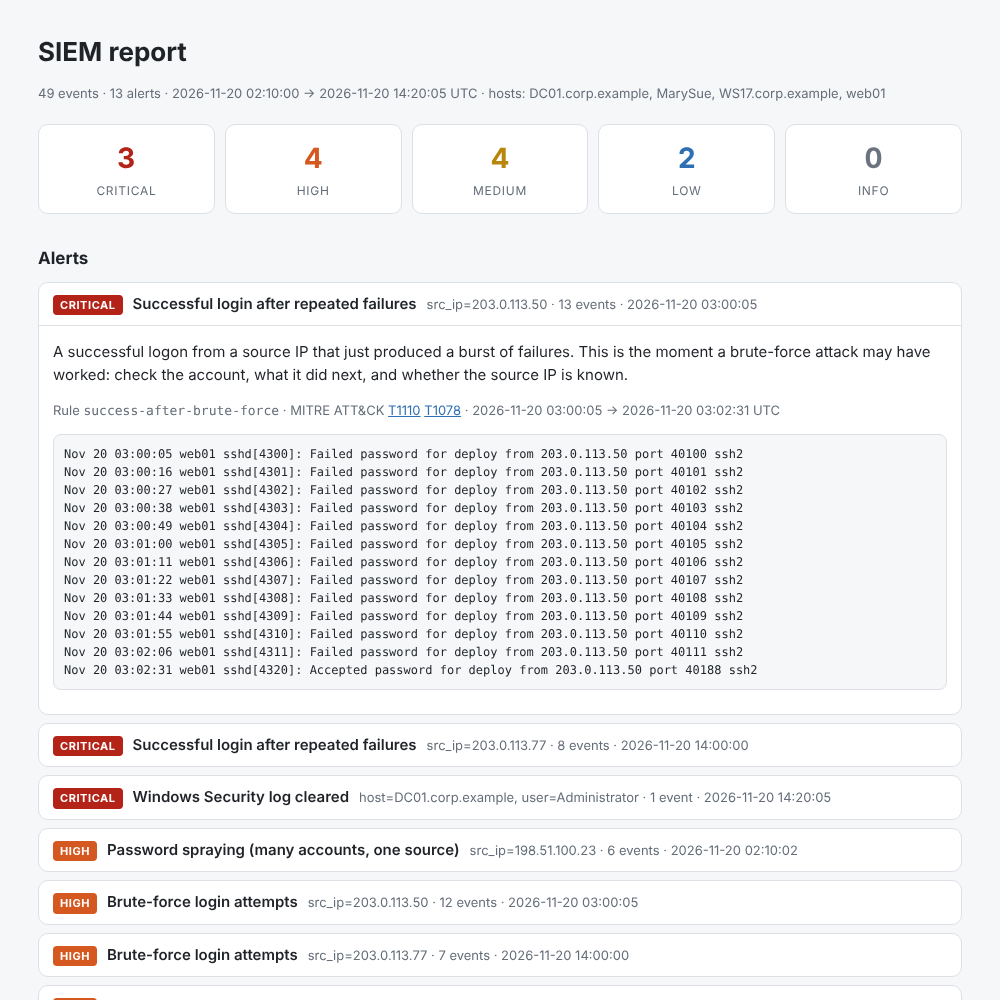

# SIEM Tool

**Status:** v0.1 complete (41 tests passing, CI on Python 3.10 and 3.12)
**Repo:** [cntcheatkarma-stack/siem_tool](https://github.com/cntcheatkarma-stack/siem_tool)
**Category:** SOC / blue team, detection engineering
**Language:** Python (PyYAML, SQLite)

## Summary

A lightweight SIEM that covers the core SOC workflow end to end: **collect → parse → normalize → detect → alert → investigate.** It reads Linux auth logs and Windows event logs, normalizes them into one schema, runs YAML detection rules mapped to MITRE ATT&CK, and produces a console table, JSON, or an HTML report.

## What it does

- **Parsers:**
  - Linux `auth.log`: SSH, sudo, useradd
  - Windows events 4624, 4625, 4672, 4720, 4104 and 1102, from nested or flat JSON
- **Rule engine:** three rule types:
  - *match:* every event that passes a filter
  - *threshold:* N events, or N distinct values, per group within a time window
  - *sequence:* N failures followed by a success
- **10 built-in detections:**
  - Brute force and password spraying
  - Success after brute force
  - Suspicious PowerShell and PowerShell file deletion
  - New accounts
  - sudo abuse
  - Special privileges
  - Audit log cleared
- **Storage:** SQLite, with no duplicates when the same logs are ingested twice
- **Reports:** console, JSON, and a self-contained HTML report

## Design highlights

- **Normalize, then detect.** Rules only see the shared schema, so one brute-force rule covers both SSH and Windows logons.
- **Rules are data.** New detections are YAML, not code, the same idea as Sigma.
- **One attack = one alert.** Threshold rules absorb the whole burst to keep alert fatigue down.
- **Slow attacks.** The sample password spray stays under the brute-force rate, and a distinct-user threshold catches it anyway.
- **Logs are treated as hostile input.** All log content is HTML-escaped in the report, and there's a test that a `<script>` username can't run in the analyst's browser.
- **Supply-chain hygiene.** The CI actions are pinned to commit SHAs and pass [gha-lint](../gha-lint/).

## Sample attack story

Synthetic logs (documentation IP ranges) tell this story:

1. A slow password spray.
2. An SSH brute force that succeeds.
3. A sudo root shell, then a new backdoor account.
4. On the Windows side: an Administrator brute force, then a PowerShell download cradle, a file deletion, and the Security log being cleared.

All 13 expected alerts fire, and the normal admin activity mixed in stays quiet.

## What I learned

- Writing a rule is easy. Making it fire *once per attack* and *not on normal activity* is the real work.
- Log formats have sharp edges: syslog has no year, Windows writes 7-digit fractional seconds, and a "NOT in sudoers" line contains the same fields as a successful sudo.
- Testing detections needs both malicious *and* benign samples.

## Next

Impossible-travel detection (GeoIP), Sigma rule import, more log sources (Sysmon, web, firewall), a live tail mode, and a full investigation write-up from the sample alerts.
